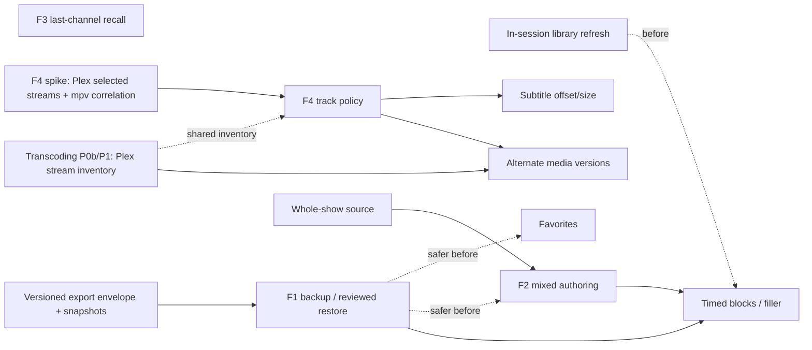

# Feature Validation Findings

**Status:** research and planning recommendations, October 14, 2026. Nothing
here approves UI, data migration, preference precedence, or implementation.
It answers the [Opus validation request](opus-feature-research-request.md) and
challenges the [feature opportunity report](feature-opportunity-report.md).

**Inspected state:** `codex/desktop-ui-second-pass` at
`eede9bb395054a54c64ff4263b861786bb907a08`. The working tree matched the
request's description: the uncommitted Flutter 3.47.7 / upload-artifact 7.0.2 /
jni_flutter 1.0.4+1 upgrade (CI, docs, engine patch, build metadata, native test
files, `pubspec.lock`) plus the two untracked research documents. This pass
changed only this file and one index entry in [docs/README.md](README.md). No
product tests ran; every claim below is from a source reading or public
documentation, labelled as such.

## Executive recommendation

| Feature | Verdict | One-line rationale |
| --- | --- | --- |
| F3 Last-channel recall | **Proceed to planning** | Small, high-confidence gap. One coordinator hook covers every tune path. The decisions are about semantics and the shortcut, not architecture. |
| F1 Backup/export + reviewed restore | **Proceed to planning, refined** | The highest protection value. The current strict, unversioned `state.json` makes downgrades and data damage worse than the report suggested. Scope v1 to the same server, one profile/server lineup, whole-lineup replace with preview, and a mandatory pre-restore snapshot. |
| F4 Track preferences | **Investigate first, then plan** | The report missed two facts. Lineup ignores the user's Plex account preferences today, and the approved transcoding plan writes track choices to Plex. Decide the preference source before designing UI. |
| F2 Mixed-source authoring | **Refine and combine** | The report's own example (alternating two sitcoms) does not work as described. Two of the three rhythms ignore source order. Dynamic "whole show" sources do not exist. Plan F2 together with a series source and a rhythm decision. |

**Next small feature: F3.** It fixes a misleading behavior: "Previous
channel" means the neighboring number, not the channel you were watching. The
change is mostly Dart, reuses the existing tune success path, and needs no
schema change if history is kept for the session only.

**Next larger feature: F1.** Every other candidate adds user-authored state:
favorites, track preferences, series sources, and mixed-source edits. F1 makes
that state recoverable. It also introduces the first versioned envelope, which
future formats need. Its controller path already exists: restore is another
reviewed lineup application.

The strongest addition the report underweighted is **in-session library
refresh**, which is reliability work. Today, Plex changes reach a running app
only through a Channel Setup rescan or a restart. **Favorites** remains the best
new everyday-use candidate.

## 1. Feature verdicts

### F3 Last-channel recall — proceed to planning

**Gap (confirmed).** [PlayerCoordinator.previousChannel](../lib/playback/player_coordinator.dart:1214)
calls `_tuneOffset(-1)`, which moves to the neighboring index. The OSD labels this
"Previous channel", and Page Up is bound to it. No history of watched channels
exists. The Guide, Mini Guide, number entry, search, and OSD all reach
`tune()`, so one owner can record history.

**What "success" already means.** `_performTune` persists the current channel
through [setCurrentChannel](../lib/app/lineup_controller.dart:2133) only after
`player.load` readiness. If a newer generation supersedes the tune, it restores
the previous ID, and it returns `true` only when generation, active request,
channel, and error state all agree. History should be promoted **on that `true`
result**, not when the tune is requested.

**Recommended envelope.**

- Keep two identities for the active profile/server scope: *current* (last
  successful) and *recall* (the one before it). Promote on success only. A
  continuation re-tune of the same channel and a retry never change recall.
- Session-only for v1, so no schema change. Clear on profile, server, or
  sign-out scope retirement through the existing `_retireScope` epoch. Drop
  `recall` when its channel is deleted or the lineup is replaced.
- Recall is an ordinary live-join tune. It does not resume a position.
- When `recall` is unavailable, the action is disabled with an explanation. It
  is not hidden behind a no-op.
- Entry points that avoid redesigning the protected Player: a keyboard
  accelerator plus a contextual **Lineup menu** entry ("Back to 12 · Name"),
  following the precedent for the Now Playing menu entry
  ([UX audit finding 6](ux-functionality-audit.md)). Optionally add a Mini
  Guide affordance later. Adding an OSD button is a protected-layout change.

**Shortcut collision analysis (source).** `Backspace`/`Esc`/Back are the Player
and Guide Back action ([player_view.dart:197](../lib/playback/player_view.dart:197)).
Digits, including `0` and `numpad0`, start channel-number entry
([player_view.dart:3483](../lib/playback/player_view.dart:3483)). `A`, `C`, `S`,
`F`, `G`, `I`, `J`, `K`, `L`, `P`, F2/F3/F11, and arrows are taken. Kodi's
documented convention is `0` to switch between the two last live channels
([Kodi keyboard controls](https://kodi.wiki/view/Keyboard_controls), wiki
revision of June 14, 2023). Lineup numbers start at 1, so a lone `0` is never
a valid channel, but it does currently begin a leading-zero entry. Channels
uses a double-press of Play on remotes
([Channels Live TV](https://getchannels.com/docs/apps/usage/live-tv/)), which
collides with play/pause here.

**Decisions needed.** Shortcut: `0` when no entry is pending (Kodi parity,
which costs leading-zero entry), or a free letter such as `R`. History scope:
session versus persisted. Whether the Guide also offers recall. Whether the
target during a failed tune is the last *successful* channel; the recommended
default is yes.

**Relative effort/risk:** small; modest async risk (superseded and late tunes).

### F1 Lineup backup/export and reviewed restore — proceed, refined

**Gap (confirmed, larger than reported).**

- [PersistedState](../lib/persistence/app_store.dart:11) has **no format version**.
  Both it and [LineupSettings.fromJson](../lib/settings/lineup_settings.dart:116)
  reject unknown fields. An older build reading a newer `state.json` treats it as
  corrupt, moves it to quarantine, and starts empty. The transcoding plan already
  records this downgrade risk for its P4 settings. Every feature in this register
  that adds a field (favorites, track preferences, series sources) widens it.
- `.pre-desktop-ui` ([app_store.dart:225](../lib/persistence/app_store.dart:225))
  is a one-time migration copy. Quarantine keeps bytes after corruption, but no
  user-visible path restores them.
- [Product Parity](product-parity.md) classifies channel import/export as
  `NOT APPLICABLE` ("Do not promote latent code"). Accepting F1 reclassifies
  that row; it is a new Desktop capability, not latent Electron code.

**Identity facts that bound portability (source).** Channels are keyed by Plex
Home profile ID and server `clientIdentifier`. Library sources store server-local
section IDs. Manual and playlist sources store server-local `ratingKey`s; manual
items embed titles, summaries, and cast names. Genre, collection, studio, actor,
director, and decade filters are stored as **titles**, so they would survive a
library remap. Manual items carry no Plex `guid`, so cross-server remapping of
hand-picked programming is impossible from current data. That confirms the
report's same-server v1, with a concrete reason.

**Recommended envelope (v1).**

- **Export:** one profile/server lineup per file. Include channels exactly as
  persisted (anchor, seed, `scheduleVersion`, `scheduleTransition`,
  `builderKey`), selected library IDs, and optionally global settings. Use an
  explicit envelope: format name, envelope version, app version, creation time,
  and source profile/server IDs with display names. Exclude tokens (they live in
  the keychain), the `plex-client-identity` file, other profiles, quarantine
  data, and `.pre-desktop-ui`. Warn plainly that the file contains private media
  titles and descriptions.
- **Restore:** validate within a byte/count bound using the existing strict
  `Channel.fromJson`/`validateChannels`. Refuse future envelope versions and a
  different server without touching state. Show a review of added, replaced,
  and removed channels and any sources now unavailable. Apply through the
  **existing reviewed lineup-application path**, which already compares the
  captured base in the state-operation queue and returns a stale result
  without writing. Replace the whole lineup for that scope in v1. Per-channel
  merge, with number conflicts, is a later extension.
- **Snapshots:** take a mandatory automatic snapshot before restore so restore is
  itself reversible. Also strongly consider small rolling snapshots before
  other destructive operations: Generate→Replace, batch delete, restore. This
  addresses the commonest real loss (a mistaken bulk operation) at a fraction
  of F1's cost.
- **Active playback:** restore behaves like Generate→Replace. If the current
  channel disappears, the existing current-channel invalidation applies, and
  playback is never silently rebound.
- **Scheduling identity:** anchors and seeds are part of the channel, so a
  same-server restore reproduces the schedule. This holds only while Plex
  membership and durations are unchanged; the round-trip test must state that
  assumption.

**Decisions needed.** Whether an export may include several profiles (default:
no). Whether settings are included (default: optional and global, restored
only on explicit choice). Merge in v1 (default: replace only). Rolling
snapshot count and whether a restore UI lists snapshots (default: last 3 per
scope, restore from the same review flow). Where the UI lives: Settings →
Account versus Channels; this needs design agreement.

**Relative effort/risk:** medium; persistence/privacy risk, mitigated by reusing
the reviewed-application path.

### F4 Preferred language and accessibility tracks — investigate first

**Gap (confirmed, with two facts the report missed).**

1. **Lineup currently ignores the user's Plex preferences.** Direct Play hands the
   part to libmpv with no `alang`/`slang`. Track selection is per load, and each
   new load clears it ([player_coordinator.dart:881](../lib/playback/player_coordinator.dart:881)).
   [parseMediaItem](../lib/plex/plex_client.dart:1609) keeps only the first
   `Media`, and library scans do not fetch per-item streams. Pinned mpv then
   prefers default-flagged tracks
   ([`compare_track`](https://github.com/mpv-player/mpv/blob/14f2d48cbc7dda61adb4bd181e107a1f3f76e533/player/loadfile.c#L561)).
   Plex states that its own selection **ignores** MKV default flags and that a
   manual per-item selection permanently overrides automatic choice
   ([Plex account audio/subtitle settings](https://web.archive.org/web/20260531080638/https://support.plex.tv/articles/204985278-account-audio-subtitle-language-settings/),
   modified July 24, 2025, read via archive because support.plex.tv returns
   403 to automated readers). Lineup can therefore choose different tracks
   than every official Plex app does for the same item.
2. **The transcoding plan already writes track choices to Plex.** Decision 4 of
   the [transcoding plan](plex-transcoding-implementation-plan.md) uses
   `PUT /library/parts/{id}` for **session** track changes. That persists as the
   user's server-side default for the item. Automatic preference application
   inside a session would then need a server write per program, which is
   exactly the silent write the request forbids. P0 also showed per-request
   selection parameters are ignored.

**Peer semantics (primary sources).**

- Plex: account-level auto-select; a preferred audio language with an
  unknown-language fallback; one preferred subtitle language; modes
  Manually Selected / Shown with Foreign Audio / Always Enabled; forced flag used
  with foreign audio. SDH and forced *search* preferences apply only to
  on-demand subtitle search, not to embedded-track selection (same page).
- Jellyfin (server `master` at `aec42b34`, October 14, 2026): modes Default,
  Always, OnlyForced, None, Smart. It has `PlayDefaultAudioTrack` and
  `RememberAudio/SubtitleSelections`. Its selector
  ([MediaStreamSelector.cs](https://github.com/jellyfin/jellyfin/blob/master/Emby.Server.Implementations/Library/MediaStreamSelector.cs))
  does not consider hearing-impaired or audio-description flags.
- Pinned mpv `14f2d48c`: `alang`/`slang` priority lists,
  `subs-with-matching-audio`, `subs-fallback`, `subs-fallback-forced`. Its
  selector also ignores hearing- and visual-impaired flags.

So **SDH and audio-description preference is beyond both Plex and Jellyfin.**
That supports it as Lineup value, but the facts are thin: the
[track-label P0 inventory](audio-subtitle-track-label-implementation-plan.md)
found no commentary, audio-description, image-subtitle, or non-English sample
on Windows, and pinned mpv turns `und` into an absent language.

**Credible alternatives.**

| Option | Strength | Cost |
| --- | --- | --- |
| A. Follow Plex: fetch item metadata at tune and honor PMS `selected` streams | Official-app parity, including per-item manual choices; no new Settings surface; one stream inventory shared with transcoding P1 | One cancellable request per program load; needs Plex-stream→mpv-track correlation (native projection of `ff-index`/`src-id`, a bounded native change); Plex-managed external subtitles are not loaded in Direct Play |
| B. Lineup-local policy (languages, subtitle mode, forced, SDH, AD, exclude commentary) | Works without the extra request; can deliver the accessibility value; consistent across servers | A second preference surface that diverges from Plex; no knowledge of per-item manual choices; Settings design needed |
| C. Pass `alang`/`slang` to mpv | Selection at load, no audible switch | Splits policy into native code; cannot express SDH/AD; violates "Dart owns product decisions" |

**Recommended direction.** One Dart `TrackSelectionPolicy` with a normalized
stream inventory as its input. Direct Play supplies observed mpv tracks;
sessions supply Plex streams from the transcoding plan's P1 metadata parsing.
Ship **A as the default behavior** when the spike confirms correlation.
Consider B's accessibility preferences as an optional layer on top. In
sessions, do not apply automatic preferences by PUT: let PMS's own selection
stand, and reserve PUT for an explicit user change as already decided. Keep
requested, commanded, and observed-confirmed selection distinct, using the
existing [selectTrack](../lib/playback/player_coordinator.dart:1339) contract.

**Investigation spike (portable plus a live read-only check).**

1. Confirm that item metadata carries `selected` on Stream elements for an owner
   and a managed profile. This is a read-only PMS request.
2. Confirm that pinned mpv exposes `ff-index`/`src-id` in `track-list` and that
   it matches Plex `Stream.index` for MKV/MP4 test media.
3. Measure whether switching tracks at first readiness is audible or visible.
   If it is, apply selection while `startPaused` holds.
4. Find or create representative media with commentary, AD, SDH, forced, and
   `und` tracks. Without them, the accessibility claims stay unproven.

**Decisions needed.** Default source: Plex versus local versus file defaults.
Changing from today's mpv defaults is a behavior change. Lifetime of a manual
change: the recommended default is the current program, including later parts
and a re-tune of the same program, with an explicit "always use this"
promotion. Whether commentary is excluded by default. SDH-versus-AD priority.
Whether local preferences are per profile or global.

**Relative effort/risk:** medium; larger if delivered inside the transcoding
session work. Physical Windows media and live PMS are required for acceptance.

### F2 Mixed-source authoring — refine and combine

**Gap (confirmed).** [ChannelStudioDraft.configureSource](../lib/app/channel_studio_draft.dart)
maps `MixedSource` to no choice. Studio shows "This mixed source is preserved
exactly" and offers only replacement. [MixedSource](../lib/channels/channel.dart:134)
already exists, nesting is validated to depth 25, and the
[resolver](../lib/channels/content_resolver.dart:22) concatenates or does
round-robin [interleave](../lib/channels/content_resolver.dart:165). The
**Channel Builder already generates** mixed sources: cross-library "Combine
matching …" proposals are `MixedSource(interleave: true)` with
`PlaybackMode.shuffle`.

**Corrections to the report's premise (source).**

- **Source order and interleave only matter for "In order".** The
  [scheduler](../lib/channels/scheduler.dart:189) sorts shuffle input by media ID
  ([`_canonicalShuffleInput`](../lib/channels/scheduler.dart:444)). "Mix it up"
  therefore gives the same schedule for concatenate and interleave and weights
  each source by item count. A 200-episode show swamps a 20-episode show.
  [`blockOrder`](../lib/channels/scheduler.dart:470) ("Mini-marathons") already
  rotates series in seeded order regardless of source structure. The builder's
  `interleave: true` flag on shuffle channels has no schedule effect.
- **"Alternate two sitcoms" lacks a dynamic source.** No series/whole-show
  source exists ([UX audit finding 3](ux-functionality-audit.md), still open).
  Today, two shows means hand-picked episodes (frozen inventory) or a Plex
  collection filter. Mini-marathons over such a source already produces
  alternation.
- **Unequal lengths under "In order" + interleave:** round-robin until the
  shorter source runs out, then a tail of only the longer source, then the cycle
  repeats. Repeating the short source to keep alternation would change cycle
  length, potentially by a large least-common multiple.
- **One unavailable child blocks saving the whole mix.** `_liveSourceError`
  returns the first child error. An editor must report status per child.

**Recommended envelope.** A flat, ordered list of child sources (Library with
filters, Plex playlist, Hand-picked, and a new **Whole show** series source),
with an explicit combination: *Back to back* or *Alternate*. Studio explains
how each rhythm treats it: In order honors it; Mix it up pools everything by
item count; Mini-marathons rotates shows. Nested legacy data stays
inspectable and preserved; editing it offers "flatten" only as an explicit,
previewed choice. Air Check, Guide, and Player stay on the one resolver and
scheduler. **Equal-weight or weighted rotation** (Tunarr's weighted random
slots, [Tunarr random slots](https://tunarr.com/configure/scheduling/random-slots/))
is a separate new rhythm, not a rename of interleave.

**Decisions needed.** Whether F2 includes the series source (recommended) or
follows it. Whether a "Balanced" rhythm (equal share per source) is in scope.
How the repeated occurrences of an item present in two children are handled;
the recommended default is to keep both, matching current resolver
semantics. Whether the builder should stop emitting the meaningless
`interleave: true` on shuffle channels. That is cosmetic, but changing it
alters canonical source identity, so it needs a no-op migration decision.

**Relative effort/risk:** medium-large with the series source; mostly Dart.

## 2. Peer matrix

**O** = observed in the cited primary documentation or source. **—** = not
found there; this is not proof of absence. **n/a** = outside the product's
model. All sources were read October 14, 2026, except where an archive date is
given.

| Capability | Lineup now (source) | Plex apps | Channels | Tunarr | ErsatzTV | dizqueTV 1.5.x | Jellyfin | Kodi PVR |
| --- | --- | --- | --- | --- | --- | --- | --- | --- |
| Backup / restore | No user workflow; one-time migration copy | n/a | — | O: scheduled tar/zip archives; restore is **manual** ([backup](https://tunarr.com/configure/system/backup/)) | — | — | — | — |
| Multi-source channel rotation | Model + builder only | n/a | n/a | O: weighted/uniform random slots, block/cyclic shuffle | O Legacy: ordered schedule items ([classic](https://ersatztv.org/docs/scheduling/classic/)); Next relies on third-party scheduling ([Next](https://ersatztv.org/next-docs/)) | O: multi-server program selection ([README](https://github.com/vexorian/dizquetv)) | n/a | n/a |
| Time-of-day slots | No | n/a | n/a | O: daily/weekly time slots, pad/lateness/overflow ([time slots](https://tunarr.com/configure/scheduling/time-slots/)) | O Legacy (fixed start times) | — (README describes filler, not slots) | n/a | n/a |
| Filler / bumpers | No | n/a | n/a | O: head/pre/post/tail/mid/fallback ([filler](https://tunarr.com/configure/library/filler/)) | Legacy filler (not rechecked) | O: commercials/prerolls/branding | n/a | n/a |
| Source freshness | Startup scan; rescan via Channel Setup | n/a | n/a | — | — | O limitation: does **not** watch Plex for changes | n/a | n/a |
| Last channel | No (neighbor only) | — | O: double-press Play ([Live TV](https://getchannels.com/docs/apps/usage/live-tv/)) | n/a | n/a | n/a | — | O: `0` toggles last two ([keyboard](https://kodi.wiki/view/Keyboard_controls)) |
| Favorites / groups | No (session library filter, search) | — | O: favorites, hidden, collections with rules and per-client assignment ([manage](https://getchannels.com/docs/apps/usage/manage-channels/), [collections](https://getchannels.com/docs/channels-dvr-server/how-to/channel-collections/)) | n/a | n/a | n/a | — | — |
| Audio/subtitle language auto-select | No (mpv default flags) | O: account prefs + per-item manual override; default flags ignored | — | n/a | n/a | — | O: 5 subtitle modes, remember selections | — |
| SDH / AD auto-select | No | O: SDH/forced only for **search** | — | n/a | n/a | — | O: selector ignores HI flag | — |
| Subtitle offset / style | No (mpv supports `sub-delay`/`sub-scale`/`sub-pos`) | O: offsets for **external text** subtitles only ([offsets](https://web.archive.org/web/20260706072219/https://support.plex.tv/articles/subtitle-offsets/)); HTPC text size/position, not ASS/image ([HTPC](https://web.archive.org/web/20261008054537/https://support.plex.tv/articles/htpc-settings/)) | — | n/a | n/a | — | — | — |
| Alternate media versions | First `Media` only | Automatic (not rechecked) | n/a | — | — | — | — | — |

**Inferences, not observations.** The Plex pages read here do not cover
last-channel or favorites for *library* content; Plex has no virtual-channel
concept there. Only Plex Live TV/DVR (tuner) is comparable,
and it was not rechecked. Peer presence shows a pattern exists; it is not
evidence of demand from Lineup users. Lineup's mpv can offset *embedded*
subtitles locally, which Plex's server-side model cannot. Treat that as a
possible advantage, not a parity requirement.

**Project currency (GitHub, October 14, 2026).** Tunarr v2026.10.2 (Oct 12).
ErsatzTV Legacy v26.11.3 (Oct 13), with Next active. dizqueTV latest release 1.7.0
(Dec 15, 2025), repository active. Kodi active. Nothing in the Tunarr,
ErsatzTV, or dizqueTV server/streaming architecture is a Lineup requirement.

## 3. Reconciled candidate register

| Candidate | Classification | Evidence and reason |
| --- | --- | --- |
| F3 last-channel recall | **Recommend** | §1 |
| F1 backup/restore | **Recommend (refined)** | §1; reclassifies Product Parity's import/export `NOT APPLICABLE` row |
| Automatic pre-destructive snapshots | **Merge into F1** | Cheap guard for Replace, batch delete, restore |
| State format version / downgrade guard | **Merge into F1** (or a prerequisite) | Strict unversioned `PersistedState`; transcoding P4 already records the quarantine-on-downgrade risk |
| F4 track preferences | **Investigate, then plan** | §1; shares stream inventory with transcoding P1 |
| F2 mixed-source authoring | **Recommend, refined, combined with series source** | §1 |
| Whole-show (dynamic series) source | **Existing finding; merge with F2** | [UX audit finding 3](ux-functionality-audit.md) remains open; no series source in `ContentSource` |
| Balanced/weighted rotation rhythm | **Investigate** (with F2 decisions) | New scheduling policy; Tunarr precedent |
| In-session library refresh / Guide freshness | **Recommend (reliability)** | No ready-state refresh or revalidation; rescan lives only in Channel Setup. Scenario A fixed; Scenario B live refresh still open ([investigation](guide-freshness-collection-investigation.md)). Must keep authoritative/partial/failed distinctions and never rebind by name |
| Favorites | **Recommend** | No model field; Guide has a session library filter that a Favorites filter could extend. Decide surfing (Page Up/Down) and number-entry behavior |
| Channel groups (user-defined) | **Defer** | Channels' rule-based collections are richer than current need; reassess after favorites |
| Subtitle offset / size | **Defer behind F4** | mpv supports it locally for embedded text subtitles; controls belong in the protected track drawer, which needs Player approval |
| Audio delay | **Defer** | No reported need; HTPC treats it as a per-refresh-rate offset |
| Alternate media versions | **Existing plan gap (P2); investigate** | Parser keeps the first `Media`. A version with a different duration must change `ChannelItem.duration`, a schedule input. Otherwise the continuation plan's 30-second catch-up skips programs. Must coordinate with transcoding (`mediaIndex`). Plan after F4 |
| Timed / weekly programming blocks | **Defer** | High value, but it rewrites the schedule domain (timezone/DST, lateness, gaps, migration). Requires F1 first |
| Bumpers / filler | **Defer** | Depends on timed blocks; filler-in-Guide and overrun policy unresolved |
| Remembered builder configuration | **Investigate (small)** | Setup reentry plan is implemented (`LineupRestoreView`). Builder strategy choices are not persisted. Value mainly for "Refresh matching generated channels" |
| Durable diagnostic export | **Defer** | **Copy redacted report** exists ([diagnostics_view.dart:107](../lib/app/diagnostics_view.dart:107)). A file save adds little beyond the clipboard. Product Parity rows 338/368 ("Flutter only displays session entries") are stale |
| Actor/studio combine mode | **Already implemented** | "Combine matching genres/studios/actors/directors" controls ([channel_setup_view.dart:1547](../lib/app/channel_setup_view.dart:1547)) with builder, projection, and controller tests. Product Parity row 216 (`MISSING`) is stale |
| Single-instance restore/focus | **Already implemented (native)** | [main.cpp](../windows/runner/main.cpp) uses a named mutex and focuses the existing window. Product Parity row 365 ("Flutter has no owner, blocked by decision") is stale. Multi-window remains unrequested |
| Launch destination / start fullscreen | **Defer** | No evidence of need; must not disturb saved-lineup startup |
| In-app mute/volume | **Investigate (small)** | `setVolume` exists in the native transport with **no Dart consumer**. OS volume works. Mute is a common TV expectation, but needs an entry point without OSD change |
| Watch-state reporting (scrobble) | **Reject for now** | Transcoding decision 6 sends no timeline reports. Surfing must not mark items watched, and `includeWatched: false` channels would shrink as you watch |
| Parental/content-rating channels | **Reject as a Lineup feature** | Managed Home profiles and PMS restrictions already own this |
| Profile-token compensation, buffering, native CTest gate | **Correctness/reliability work** | Tracked in the review records; not features |
| Physical Windows acceptance (track labels P4, HDR, continuation, scaling) | **Release obligation** | Batched into the maintainer's final full-app pass |
| Signing, notices, installer/updater, distribution | **Release-policy decisions** | [Product Parity](product-parity.md) evidence-gap register |
| HTTP-only servers, passthrough/device selection, gamepads, refresh-rate switching | **Defer: needs capability/security decision** | Peers offering them (e.g., Plex HTPC refresh switching) does not approve them |
| Recording, offline downloads, multiview, other providers, cross-device sync | **Reject for current roadmap** | Material product expansion with no concrete use case here |

**Stale documentation to correct when the related work lands:**

- Product Parity rows 216, 338, 365, and 368.
- [User Guide](user-guide.md) §Channels says Custom Studio programming uses
  Library or Hand-picked, with playlists only preserved. Studio offers a
  **Plex playlist** choice for new custom channels.

## 4. Ranked short list

| Rank | Item | Value | Confidence | Effort | Maintenance | Fit | Dependencies | Verification feasibility |
| --- | --- | --- | --- | --- | --- | --- | --- | --- |
| 1 | F3 last-channel recall | Medium, daily | High | Small | Low | One coordinator hook | None | Portable coordinator/widget tests; physical keyboard row |
| 2 | F1 backup/restore + snapshots + format envelope | High (protects everything) | High | Medium | Low–medium | Reuses reviewed application path | Design agreement on location | Mostly portable; Windows app-data row |
| 3 | In-session library refresh | High for long sessions | Medium (Scenario B unobserved) | Medium | Medium | Existing scan/attempt owners | Investigation of B | Portable fakes; live PMS row |
| 4 | Favorites | Medium-high, daily | High | Small–medium | Low | Guide filter and controller | Better after F1 envelope | Portable |
| 5 | F4 track policy (Follow Plex first) | High for multilingual/accessibility users | Medium until spike | Medium | Medium | Single Dart policy shared with transcoding | Spike; transcoding P1 inventory | Requires live PMS and Windows media |
| 6 | F2 mixed authoring + series source | Medium-high for curators | High on semantics | Medium-large | Medium | Existing model/resolver | Rhythm decisions | Portable; Air Check parity |
| 7 | Subtitle offset/size | Medium | Medium | Small–medium | Low | Native mechanism exists | F4; Player approval | Windows visual |
| 8 | Alternate media versions | Medium | Medium | Medium | Medium | Schedule input | F4, transcoding | Live PMS fixture |
| 9 | Timed blocks, then filler | High, long-term | Low (design open) | Large | High | New schedule domain | F1, F2, freshness | Portable scheduler plus a long soak |

**Why F3 next:** it fixes a mislabelled behavior at small cost, with the lowest
risk of any user-visible change, and it builds no new state format.

**Why F1 as the larger item:** every feature after it adds durable,
user-authored state into a strict, unversioned file. F1 is what makes that safe
to try. It also gives the reviewed restore and snapshot tools that richer
scheduling (F2, timed blocks) will want for undo. Its async/persistence owner
already exists.

## 5. Questions for the maintainer

The defaults below are proposals with tradeoffs, not approvals.

1. **F3 shortcut.** `0` when no number entry is pending (Kodi convention; gives
   up leading-zero entry) or a letter such as `R`? *Proposed: `0`.*
2. **F3 surface.** Is a contextual Lineup-menu entry acceptable as the visible
   path, leaving the protected OSD unchanged? *Proposed: yes.*
3. **F3 persistence.** Session-only history (no schema change) or persisted per
   profile/server? *Proposed: session-only.*
4. **F1 scope.** One profile/server lineup per file, same server only, whole
   replace with preview and an automatic pre-restore snapshot? *Proposed: yes.*
   Merge later.
5. **F1 settings.** Include global settings as an opt-in section? *Proposed: yes,
   restored only on explicit choice.*
6. **F1 snapshots.** Keep rolling snapshots before destructive lineup operations?
   *Proposed: last 3 per scope.*
7. **F1 location.** Where do Export, Restore, and snapshots live (Settings →
   Account, Channels, or both)? Needs design agreement.
8. **Format versioning.** Adopt a versioned envelope for exports now, and decide
   separately whether `state.json` gets a version plus a "newer data" refusal
   instead of quarantine. *Proposed: yes for exports; plan the `state.json`
   guard with the first new persisted field.*
9. **F4 default source.** Follow the Plex account selection (parity), local
   preferences, or today's file defaults? Changing the default changes current
   behavior. *Proposed: Follow Plex, after the spike.*
10. **F4 sessions.** Confirm that automatic preferences never trigger
    `PUT /library/parts`, and that PUT stays reserved for an explicit user
    change in a transcode session. *Proposed: yes.*
11. **F4 manual change lifetime.** Current program (all parts), current channel,
    or global until changed? *Proposed: current program, plus an explicit "always
    use" promotion.*
12. **F4 accessibility layer.** Offer SDH/AD/commentary preferences beyond Plex,
    given that no representative test media exists yet? *Proposed: design it,
    gate the claim on real samples.*
13. **F2 composition.** Plan F2 with a dynamic Whole-show source? *Proposed: yes.*
14. **F2 rhythm.** Is a "Balanced" (equal share per source) rhythm in scope, or
    is Back-to-back/Alternate plus the existing three rhythms enough for v1?
    *Proposed: v1 without Balanced; explain each rhythm's effect in Studio.*
15. **Freshness.** Is a manual "Refresh from Plex" action in the ready app
    acceptable before considering periodic refresh? *Proposed: yes.*
16. **Favorites semantics.** Profile/server scope; Guide filter; do Page Up/Down
    surf favorites only when the filter is active? *Proposed: scope per
    profile/server; surfing follows the active Guide filter.*

## 6. Planning sequence and dependencies

- **Independently shippable now:** F3, F1, freshness, and favorites. F3 and F1
  touch different owners (coordinator versus controller/store), so they can be
  planned and built in parallel.
- **Track preferences, versions, and transcoding:** one stream-inventory model
  serves all three. F4's Direct Play policy can ship before transcoding if its
  input is the normalized inventory. Sessions then plug in a second inventory
  source without a second policy. Media versions come after both, because the
  chosen version determines duration (schedule), part URL (Direct Play), and
  `mediaIndex` (session).
- **Programming depth:** series source → F2 → timed blocks → filler. Each one
  changes what Air Check, Guide, and Player must agree on.

## 7. Acceptance obligations per recommended feature

Existing suites are named in the [project profile](../.agents/project.md#verification-selection).
Physical rows join the maintainer's batched final Windows pass; they are not
per-feature gates.

**F3 last-channel recall**

- *Portable (coordinator tests with the existing fake native player):* A→B→recall
  returns to A, and recall again returns to B. A→B superseded by C keeps A as
  recall. A failed tune does not promote. A late readiness from a superseded load
  does not promote. Continuation and retry do not change recall. A deleted
  recall target disables the action. Profile/server switch and sign-out clear
  history. Recall joins live position.
- *Widget:* shortcut versus number-entry interplay; Lineup-menu entry visibility,
  label, semantics, focus return.
- *Physical Windows:* keyboard/remote key delivery and visible tune result.

**F1 backup/restore**

- *Portable (`app_store_test`, `lineup_controller_test`):* semantic round trip
  of every source type, including nested mixes, transitions, and repeated
  items. Identical schedule at a fixed clock with unchanged inventory.
  Future envelope version, different server, oversized and malformed input are
  rejected with state untouched. Credentials and client identity never appear
  in the export. A cancelled preview leaves saved and published state
  unchanged. Failed save rolls back and keeps the pre-restore snapshot.
  A stale base (lineup changed during review) returns a stale result. The
  current channel is removed or preserved correctly during active playback.
  Snapshot rotation keeps its count bound.
- *Widget:* review list, unavailable-source warnings, privacy notice, focus.
- *Physical Windows:* export/restore in real app-data paths, including a
  read-only or locked target. This joins the existing physical state-file
  recovery row.

**In-session library refresh**

- *Portable:* refresh is cancelled and rejected when stale. A partial or failed
  refresh never replaces authoritative inventory. Same-name collection recreation
  resolves by title within the library without rebinding other sources.
  Guide/Player schedules change only when membership or duration change.
- *Live PMS:* the guide-freshness investigation's Scenario B procedure.

**Favorites**

- *Portable:* persistence and compatibility (old state loads; deleted channels
  drop out). The filter combines with search and library filters. Surfing and
  number entry follow the agreed semantics. Included in backup/restore.
- *Widget:* toggle path, semantics, focus restoration.

**F4 track policy**

- *Portable (`player_coordinator_test`, transcoding P1 fakes):* the policy table
  over ambiguous, missing, and `und` metadata. Unknown stays distinct from a
  negative flag. The preferred track is unavailable. Manual override lifetime
  holds across parts, programs, and re-tunes. Stale native events and selection
  timeout keep the prior confirmed selection. Automatic policy never issues
  `PUT` in a session.
- *Native (track-list encoder CTest):* projection of the correlation field,
  within the existing bounds.
- *Live PMS:* `selected` streams for owner and managed profiles; per-item manual
  override is honored.
- *Physical Windows:* the heard audio and rendered subtitle match the confirmed
  selection on representative media, including forced, SDH, AD, commentary,
  and `und` once samples exist. Startup switch audibility.

**F2 mixed authoring with series source**

- *Portable:* inspect, edit, and save round trip for existing nested mixes, which
  stay byte-identical unless explicitly flattened. Unequal, empty, and
  unavailable children are reported per child. Deliberate repeated occurrences
  are preserved. Each rhythm's order effect matches the explanation shown.
  Air Check, Guide, and Player give equal results at a fixed clock. A series
  source picks up new episodes after a refresh and stays distinct across
  libraries. Conflict and cancellation recovery work.
- *Widget/accessibility:* source-list reorder without a pointer, per-child
  status semantics.
- *Physical Windows:* none beyond the general final pass. This is Dart-owned
  behavior.

Portable tests establish Dart contracts against fakes. They do not establish
live Plex behavior, native media output, or physical input/assistive-technology
behavior. Each row above names where that distinction applies.

## Remaining research gaps

- Plex Live TV/DVR client favorites and last-channel behavior were not
  rechecked.
- ErsatzTV Legacy filler details were not rechecked.
- Jellyfin Live TV favorites were not checked.
- None of these would change the ranking above.
- Whether PMS metadata `Stream.index` aligns with pinned mpv `ff-index` for
  every container is the F4 spike's first question.
- Scenario B (collection automation) remains unobserved on a live server.
