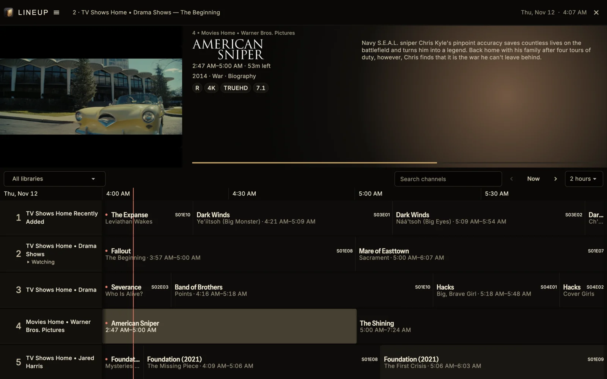

# The Guide

The Guide shows what's on every channel now and for the next few hours. The channel you're watching keeps playing in the corner while you browse.
{ .lead }

<figure>

<figcaption>The line across the schedule marks the current time. The highlighted program is the one you're inspecting, and <strong>Watching</strong> marks the channel you're tuned to.</figcaption>
</figure>

## Move around

Moving through the Guide never changes channel. Playback only switches when you select a program that's on now.

=== "Keyboard"

    | To | Press |
    | --- | --- |
    | Move between channels | ++arrow-up++ / ++arrow-down++ |
    | Move between programs | ++arrow-left++ / ++arrow-right++ |
    | Jump a page of channels | ++page-up++ / ++page-down++ |
    | Go back to now | ++home++ or ++p++ |
    | Watch the selected program | ++enter++ or ++space++ |
    | Find a channel | ++command+f++ on Mac, ++ctrl+f++ on Windows |
    | Close the Guide and return to the Player | ++escape++, ++backspace++, ++g++ or ++f2++. Without playback, these open the Lineup menu. |

=== "TV remote"

    | To | Press |
    | --- | --- |
    | Move between channels and programs | D-pad |
    | Jump a page of channels | Channel Up / Channel Down |
    | Watch the selected program | Select |
    | Reach search and the library picker | Up from the first channel |
    | Return to the Player | Back, or the Guide button if your remote has one |

From the root Guide, the Guide button opens the Lineup menu, and Back sends Lineup to the background.

Moving around only highlights programs. Selecting a program that's on now tunes its channel and opens the Player. The channel you're watching keeps playing in the corner of the Guide. When nothing is playing, the corner shows artwork for the program you've highlighted.

## Go back to now

While you stay on the current time, the Guide moves along with the clock. Once you scroll earlier or later, it stays where you left it. The **Now** button shows an arrow pointing back to the present: **← Now** when you're looking ahead, **Now →** when you're looking back.

!!! tip
    Press ++p++ or the Play button on a media remote to jump straight back to what's on now.

When you browse away from live, the Guide keeps your time window and the program you chose to inspect until you return to now. When the current time is off screen, the button's tooltip and accessible label are **Return to live**. Otherwise, it's **Now**.

## Find a channel

Use the library picker to show one library's channels, or **All libraries**. The search box takes a channel name or number and only searches the library you've picked.

## See more of the schedule

The Guide shows two hours by default. Switch to three or four hours from the menu next to **Now**. The Guide shows five channels at a time, or six on taller screens such as MacBooks and 16:10 monitors. Small windows and larger text keep the rows comfortable by making the picture smaller first, and show fewer channels only when there isn't room for five. You can browse earlier in the schedule with the time controls. The Guide has no separate past-window or row-density setting.

## Program details

The area above the schedule describes the program you're on: time left or duration, year, genres and a synopsis. By default its background takes its color from the poster. In **Settings** → **Appearance** you can use the program's backdrop or your theme instead. Turn on **Use title artwork** to show Plex title logos in place of text.

!!! note
    Programs that have already finished show only their time range. Programs still to come show their length.

The synopsis uses the available height and ends with an ellipsis when it needs more room. If there's no synopsis, the rest of the program details use that space. In a compact layout, year and genres can share the time line. Catalog facts can include resolution, dynamic range and audio.

A long title scrolls in the focused program cell. Other cells keep their titles still and shorten them to fit. **Reduce motion** turns the scrolling off.

??? note "Details"
    A program with a poster keeps the same poster space while the image loads or if it fails. A program with no poster reference uses that space for details. A missing, failed, too short or too narrow title logo falls back to text.
